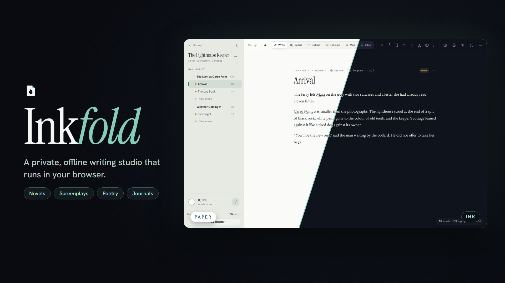
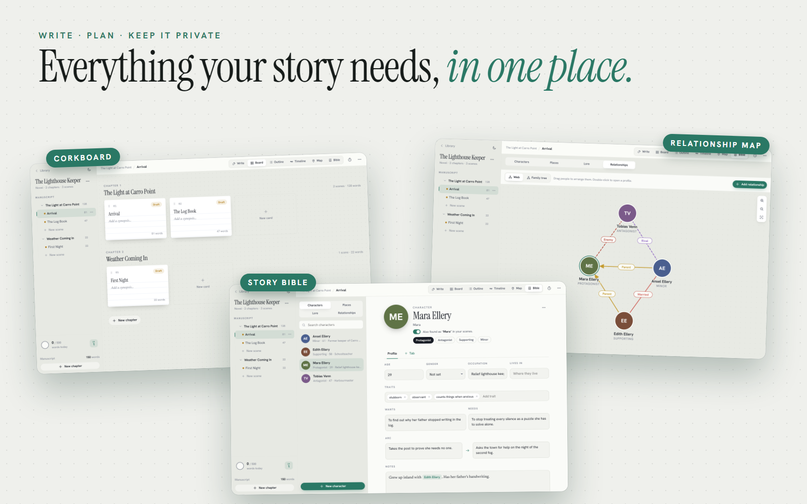

# Inkfold

**A private, offline writing studio that runs in your browser.**

## About

Inkfold is a place to write a book, a screenplay, a poem or a journal, and to keep track of everything around it: characters, places, timelines and maps.

Everything is saved on your device and works offline. Your writing never leaves it unless you sync or export it. There is no account.

*The project in these pictures, The Lighthouse Keeper, is the sample that comes with Inkfold.*

**[Try it: direkjames.github.io/Inkfold](https://direkjames.github.io/Inkfold/)**

## Features

**Four kinds of project**
- **Novel:** chapters and scenes
- **Screenplay:** scene headings, action, character and dialogue, with autocomplete, page count and `.fountain` import
- **Poetry:** new lines and stanzas, with syllable counts beside each line
- **Journal:** one entry a day, a mood for each day and a calendar view
- **Series:** group books so they share one story bible

**Writing**
- A clean editor with Markdown shortcuts, or a plain Markdown mode
- **Focus mode**, typewriter scrolling and dimming by paragraph or sentence
- Five typefaces and five editor themes (Paper, Ink, Midnight, Sepia Night and OLED Black), or match your device, plus size, spacing and width you can tune
- Pictures in scenes, with captions and resizing
- Live word counts and constant autosave
- **Read aloud** with sentence highlighting

**Planning**
- **Corkboard:** index cards per chapter with synopsis, status, point of view, label and word target. Drag cards between chapters.
- **Outliner:** a table of every scene you can edit in place
- **Timeline:** put scenes in story order with one lane per point of view
- **Story bible:** characters, places and lore with photos, traits, wants and needs, arcs and custom tabs
- **`[[Links]]`** between entries, hover cards in your manuscript, and "Appears in" for every scene that mentions a name
- **Relationship map:** a draggable web and a family tree, with ten kinds of relationship
- **Maps:** your own map pictures with pins, labels, regions and routes, maps inside maps, scene locations, travel times and character journeys
- **Import from Mapfold:** bring maps and places from the sister app and keep them in sync

**Revising**
- Margin notes, revision rounds colored by draft, and version history for every scene with side-by-side comparison
- **Find and replace** across the whole project, including regular expressions
- A revise panel with readability, adverbs, passive voice, repeated words and long sentences
- A reference pane to keep another scene or a character open beside the one you write

**Goals and habits**
- Daily word goal, streaks, a heatmap, a deadline planner and writing sprints
- EXP and levels for every word you write
- Ambient sounds (rain, fireplace, café and ocean) made on your device

**Export and backup**
- **Compile** to Word, PDF, EPUB and Markdown, and for screenplays Fountain, Final Draft and an industry-format PDF
- Import `.docx`, `.md`, `.txt`, `.inkfold` and `.zip` files
- One-click ZIP backup and restore, a daily automatic backup to a folder (Chrome and Edge on desktop), and a 30-day trash

**Privacy**
- **App lock** with a PIN, and **encrypted projects** with AES-256 and a password only you know
- **Nearby Sync** between your own devices with a pairing code or offline QR codes, with no account or server in the middle
- Installable, and works offline after your first visit

Press `Ctrl/Cmd + K` for the command palette and `Ctrl/Cmd + /` for every shortcut.

## Getting started

1. Open [direkjames.github.io/Inkfold](https://direkjames.github.io/Inkfold/) in your browser.
2. Press **New project**, or open the sample and look around.
3. Write in **Write**, plan in **Board**, **Outline** and **Timeline**, and keep your cast in **Bible**.
4. Press the install button in your browser to use it like an app, and make a backup now and then.

## Requirements

- A modern web browser (Chrome, Edge, Firefox or Safari). Some features, such as the automatic backup folder, need Chrome or Edge on a computer.
- An internet connection the first time, so the app and its fonts can load

## Built with

- HTML, CSS and JavaScript, with no build step
- IndexedDB for saving, and a service worker for offline use
- [JSZip](https://stuk.github.io/jszip/), [jsPDF](https://github.com/parallax/jsPDF), [Mammoth](https://github.com/mwilliamson/mammoth.js) and [PeerJS](https://peerjs.com), loaded only when needed
- Hanken Grotesk, Instrument Serif and other typefaces from Google Fonts

Want to run it yourself? See [Developing Inkfold](docs/DEVELOPING.md).

## Status

Shipped.

## Credits / License

Made by [direkjames](https://github.com/direkjames). See [LICENSE](LICENSE).
